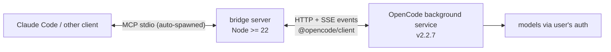

# OpenCode MCP Bridge — Verified Findings & Rebuild Plan

**Date:** 2026-11-13
**Decision:** Build a **new repository** (`opencode-bridge-mcp`) using the official OpenCode client SDK, **stdio transport**. This document is the complete, self-contained blueprint — copy it into the new repo root (e.g. as `PLAN.md`). The old `Better-OpenCodeMCP` repo will be **deleted**; everything needed from it is captured here.

**Goal:** An MCP server (**stdio transport**) that exposes OpenCode as delegate-worker tools for Claude Code (or any MCP client): start tasks, wait for results, multi-turn follow-ups, cancel, health.

> **Transport decision (2026-11-13):** stdio. HTTP (Streamable HTTP on `127.0.0.1:8831`) was considered for multi-client sharing but rejected — Claude Code auto-spawns stdio servers, so there's no daemon to manage, and "some other system" can still spawn it the same way. One bridge process per client is fine: delegated work lives in the OpenCode service, and the bridge can rebuild state from `session.list` + `session.context` after any restart.

---

## 1. Environment (confirmed live)

| Item | Value |
|---|---|
| OS | Windows |
| Node | v22.14.0 (system; no nvm) — **this is the key constraint** |
| OpenCode CLI | v2.2.7 (`opencode.ps1` via npm global) |
| Background service | Running at `http://127.0.0.1:28894`, PID 25204 |
| Service auth | Basic auth, username `opencode`, password from `~/.local/state/opencode/service.json` |
| Model auth | Z.AI Coding Plan (stored); recent models include `proxyfrost/gpt-6-luna`, `zai-coding-plan/glm-5.3-flash`, etc. |
| Service registry | `C:\Users\chinm\.local\state\opencode\service.json` (XDG state path on Windows) |

State files the bridge may read (both under `~/.local/state/opencode/`, XDG paths even on Windows):

```jsonc
// service.json — written by the background service; discover() parses this
{ "id": "<uuid>", "version": "2.2.7", "url": "http://127.0.0.1:28894",
  "pid": 25204, "password": "<secret>" }

// model.json — user's model history; default model = recent[0]
{ "recent":   [{ "providerID": "proxyfrost", "modelID": "gpt-6-luna" }, ...],
  "favorite": [...],
  "variant":  { "proxyfrost/gpt-6-luna": "high", ... } }
// model string for session.create = `${providerID}/${modelID}` (+ `#variant` if set)
```

---

## 2. Findings — old repo (`Better-OpenCodeMCP`)

### What still works (verified live, not assumed)

- `npm install` / `npm run build` / `npm test` → **293/293 tests pass**
- Full MCP stdio handshake (`initialize`, `tools/list`, `tools/call`) works
- Real task E2E: spawn → parse NDJSON → `completed` in ~4s, session ID captured
- `opencode run --format json` event schema on v2.2.7 is **identical** to what its parser expects (`step_start` / `text` / `tool_use` / `step_finish`, each with `part`)
- Model auto-detection from `~/.local/state/opencode/model.json` (`recent[0]`) still matches the file format
- Build-agent file writes work in non-TTY runs without `--auto` (verified: `hello.txt` created in temp git repo)
- Health tool reports accurate CLI/config/pool/task diagnostics

### Confirmed defects (why we're rebuilding instead of fixing)

1. **No result exposure** — `opencode_sessions` returns `status: "completed"` but never the accumulated output text. The delegating agent can never read the answer. (Text is persisted to disk, but no tool returns it.)
2. **`input_required` / `opencode_respond` is dead code** — `opencode run` is one-shot: when the model asks a question, the process exits with `step_finish(reason="stop")` in ~2s, so the task is marked `completed` and the 30-second idle heuristic can never fire. The respond tool's precondition (`input_required`) is unreachable.
3. **`sessionTitle` silently ignored** — accepted in the Zod schema, never passed as `--title` to the CLI.
4. **`fallbackModel` is fiction** — configured via wizard, stored in config, zero retry logic exists in `src/`.
5. **Prompt passed as argv through `shell: true`** — Windows `cmd.exe` 8191-char limit vs 100k schema max. (stdin works and would avoid it, but the rebuild eliminates process spawning entirely.)

---

## 3. Findings — official SDK landscape (verified live)

### Package comparison

| Package | Version | Verdict |
|---|---|---|
| `@opencode/sdk` | 2.2.7 | ❌ **Embedded host requires Node ≥ 24** — its compiled dist uses ES2026 `await using` (verified: `SyntaxError` on Node 22.14, both in user code and inside `@opencode/util/dist/flock.js`; `--experimental-explicit-resource-management` flag doesn't exist on 22.14) |
| `@opencode-ai/sdk` | 1.19.5 | Legacy V1 client (docs redirected to V2) — skip |
| `@opencode/client` | 2.2.7 | ✅ **Works on Node 22.14** — no `await using` in dist; connects to the running background service. **This is the one to use.** |

Notes:
- `@opencode/client/mcp` exists but is the **reverse direction** (expose tools *to* OpenCode via WebSocket) — not what we need.
- Client-to-shared-service beats the embedded host anyway for our use case: shares sessions/models/auth with the user's TUI, no extra process, survives MCP server restarts.
- If Node ≥ 24 ever becomes the baseline, the embedded host becomes an option, but nothing in the design depends on it.
- **Version pinning:** `@opencode/client` must track the CLI version (2.2.7 here) — pin it exactly. `discover({ version })` accepts an exact version or a predicate for a compatibility check; `client.server.info().version` enables a runtime mismatch warning. On CLI upgrade, bump the client dependency.
- **Known-good MCP-side versions** (verified live in the old repo's E2E before deletion): `@modelcontextprotocol/sdk@1.27.1` with `StdioServerTransport` (initialize → tools/list → tools/call all worked on Node 22.14) and `zod@3.25.76` for input schemas. Use these as the baseline.
- **ESM conventions that worked:** `"type": "module"`, all relative imports use `.js` extensions (required with `module: Node16`), `bin` entry pointing at `dist/index.js` with a shebang.

### API calls verified against the live service

| Call | Result |
|---|---|
| `discover()` (from `@opencode/client/service`) | ✅ Returns `{ url, auth: { type: "basic", username: "opencode", password } }` |
| `headers(endpoint)` | ✅ Builds the `authorization: Basic base64("opencode:" + pw)` header |
| `OpenCode.make({ baseUrl, headers })` | ✅ |
| `client.server.info()` | ✅ `{ version: "2.2.7", ... }` |
| `client.session.create({ title, location: { directory } })` | ✅ Returns `SessionInfo` |
| `client.session.prompt({ sessionID, text })` | ✅ **Non-blocking — returns in ~188 ms** with `SessionInboxUser` |
| `client.experimental.session.wait({ sessionID })` | ✅ Resolves on completion (~3.9 s for a short task) |
| `client.session.context({ sessionID })` | ✅ Returns typed entries (shapes below) |
| `client.session.list({})` | ✅ Returns `{ data: SessionInfo[], cursor }` |
| `client.event.subscribe({ signal })` | ✅ Rich event stream (types below) |
| **Multi-turn memory** | ✅ Codeword given in turn 1, recalled in turn 2 (6 context entries) |

### Documented but NOT yet live-verified (verify first in the new repo)

- `client.session.interrupt({ sessionID })` — spike died on auth before reaching it
- `client.permission.request.list()` / `client.permission.reply({ sessionID, requestID, decision })`
- `ensure()` from `@opencode/client/service` (auto-start service when none running) — drafted into client wrapper, never executed
- `client.session.update({ sessionID, archived: true })` (cleanup of bridge sessions)

### Key data shapes (from generated types + live output)

```ts
// session.create input
{ title?, agent?, model?: { id, providerID, variant? },
  location?: { directory }, parentID?, metadata?,
  permissions?: Array<{ action, resource, effect: "allow"|"deny"|"ask" }> }

// session.prompt input
{ sessionID, text, files?, agents?, skills?, metadata?,
  delivery?: "steer" | "queue", resume?: boolean }

// session.context() entries (union by `type`):
{ type: "user",      id, time: { created }, text }
{ type: "assistant", id, time: { created, streamed, completed }, agent, model,
  content: Array<{ type: "text", text } | ...>, finish, cost, tokens }
{ type: "idle",      id, time, outcome: "succeeded" | "failed" | "interrupted" }

// SessionInfo (from session.list / create)
{ id, projectID, agent?, model?, cost, tokens, outcome?,
  time: { created, updated, busy?, idle? }, title?, location: { directory }, ... }

// Permission flow
PermissionRequest: { id, sessionID, action, resources, save?, message? }
PermissionReplyInput: { sessionID, requestID, decision: "once" | "always" | "reject", message? }
```

### Event stream (verified subset of `V2Event`)

Lifecycle: `session.execution.started` / `.succeeded` / `.failed` / `.interrupted`
Streaming: `session.text.started` / `.delta` / `.ended`, `session.step.*`, `session.tool.*`, `session.usage.updated`
Permissions: `permission.asked` / `permission.replied` (in the type union; **not yet observed live**)
Noise to filter: `provider.updated`, `model.updated`, `plugin.updated`, `mcp.*`, etc.

`EventSubscribeInput` accepts `types?: ReadonlyArray<...>` — subscribe with a filtered list instead of parsing everything.

### CLI fallback facts (useful as degradation path / reference)

- `opencode run --format json` still works and emits the same NDJSON event schema as V1
- Prompt can be piped via **stdin** (verified) — avoids argv length limits
- `--title`, `--session`, `--auto`, `--agent`, `--model` flags all exist on v2.2.7

---

## 4. Architecture for the new server



Stdio rules: JSON-RPC **only** on stdout — all logging goes to stderr. The OpenCode service connection is outbound HTTP, which is unaffected.

### Components

```
src/
  index.ts                  # entry: MCP server (StdioServerTransport), tool registry, graceful shutdown
  serviceClient.ts          # singleton: discover()/ensure() + auth headers + lazy init
  tracker.ts                # event subscription -> per-session state (busy, last activity, partial text)
  results.ts                # extract assistant text from session.context() (filter type === "assistant")
  tools/                    # one file per tool + registry
  __tests__/                # vitest
```

### Tool surface (proposal)

| Tool | Blocking? | Behavior |
|---|---|---|
| `opencode_task` | no | `session.create` + `session.prompt`, returns `{ sessionId, title }` immediately |
| `opencode_wait` | **yes** | `experimental.session.wait` + return **final assistant text** (the missing feature in the old repo); optional `timeoutMs` |
| `opencode_status` | no | tracked sessions + `session.list` snapshot: busy/idle, outcome, cost, tokens |
| `opencode_respond` | no | `session.prompt` on existing session — real multi-turn follow-up |
| `opencode_cancel` | no | `session.interrupt` |
| `opencode_health` | no | `server.info()` version + tracked session counts |

Keep the tool count small; Claude Code works best with a tight, well-documented surface. All tools return JSON strings.

#### Tool input parameters (Zod schemas)

```ts
opencode_task:
  task: string          // required, min 1
  title?: string        // default "Task <first 40 chars>"
  agent?: string        // e.g. "build" | "plan" | "explore" — session.create({ agent })
  model?: string        // "provider/model" or "provider/model#variant"
  directory?: string    // working directory; default <package>/workdir sandbox

opencode_wait:
  sessionId: string     // required
  timeoutMs?: number    // default 300000 (5 min); resolve early with status if exceeded

opencode_status:
  sessionId?: string    // detail for one session if given; summary of tracked + recent otherwise
  limit?: number        // default 10

opencode_respond:
  sessionId: string     // required
  message: string       // required — next user turn (multi-turn follow-up)

opencode_cancel:
  sessionId: string     // required

opencode_health: {}
```

#### Tool output contracts

```jsonc
// opencode_task →
{ "sessionId": "ses_...", "title": "...", "status": "working" }

// opencode_wait → (the core fix: delegating agent finally reads the answer)
{ "sessionId": "ses_...", "status": "succeeded" | "failed" | "interrupted" | "timeout",
  "result": "<last assistant text>",          // truncated to a cap, e.g. 100 KB
  "cost": 0, "tokens": { "input": 0, "output": 0, ... } }

// opencode_status →
{ "sessions": [{ "sessionId", "title", "status": "busy"|"idle"|"unknown",
                 "outcome", "cost", "tokens", "time": { "created", "updated" } }], "total": n }

// opencode_respond →
{ "sessionId": "...", "status": "working", "message": "Follow-up delivered; use opencode_wait" }

// opencode_cancel →
{ "sessionId": "...", "status": "interrupted" }

// opencode_health →
{ "service": { "url", "version" }, "trackedSessions": n, "subscriptionActive": true }
```

### Permission handling — needs a decision

The service may emit `permission.asked` for sensitive tool calls in delegated sessions. Options:

1. **Pre-grant at session create** — `session.create({ permissions: [{ action, resource, effect: "allow" }] })` scoped per task. (Note: non-TTY runs did not stall on file-write permissions in testing, but don't rely on that.)
2. **Auto-reply "once"** from the bridge when `permission.asked` fires (mirrors `opencode run --auto`).
3. **Surface to the delegating agent** via `opencode_status` + a `opencode_permission_reply` tool.

Recommend starting with (2) + an opt-in config for (3). Verify `permission.reply` works before committing.

### Edge cases / risks

- **Node version**: pin `engines: { node: ">=22" }`; document that `@opencode/sdk` (embedded) would need Node ≥ 24 — we deliberately don't use it.
- **Service not running**: `ensure()` should start one; verify behavior + startup latency on Windows.
- **Stale auth**: service password rotates on service restart; `discover()` per startup (client is per-process singleton — fine). If the service restarts while the bridge runs, re-discover on auth failure.
- **Cost attribution**: sessions show `cost`/`tokens` — surface in `opencode_status` so the delegating agent can be cost-aware.
- **Session hygiene**: bridge sessions accumulate; consider `archived: true` on create or an explicit cleanup tool. (`opencode run --archived` exists as CLI precedent.)
- **Windows**: no process spawning at all anymore — pure HTTP. Eliminates every `shell: true` / `taskkill` concern from the old repo.

---

## 5. TODO

- [ ] Create new repo `opencode-bridge-mcp` (npm, ESM, TypeScript, vitest; `engines: node >= 22`)
- [ ] Deps: `@opencode/client@2.2.7`, `@modelcontextprotocol/sdk`, `zod`
- [ ] `index.ts` — MCP stdio server (`StdioServerTransport`), tool registry, graceful shutdown (abort event subscription on SIGINT/SIGTERM); all logs to stderr
- [ ] `serviceClient.ts` — singleton wrapper (draft below)
- [ ] **Verify** `session.interrupt` live
- [ ] **Verify** `permission.request.list` + `permission.reply` live; pick permission policy
- [ ] **Verify** `ensure()` auto-start when no service is running
- [ ] `tracker.ts` — filtered `event.subscribe(["session.execution.*", "permission.asked", ...])`, maintain per-session busy state + waiters
- [ ] `results.ts` — assistant-text extraction from `session.context()`; truncate long outputs sensibly
- [ ] Tools: `opencode_task`, `opencode_wait`, `opencode_status`, `opencode_respond`, `opencode_cancel`, `opencode_health`
- [ ] Unit tests (tracker state machine, result extraction, tool schema validation with mocked client)
- [ ] E2E harness: JSON-RPC over stdio (spawn `dist/index.js` with `stdio: pipe`, newline-delimited JSON-RPC, promise map keyed by request id) — task → wait → respond (multi-turn) → cancel → health
- [ ] README: what/why, prerequisites (Node ≥ 22, OpenCode CLI installed + `opencode auth login`), install/build, register in Claude Code (`claude mcp add opencode -- node /path/to/dist/index.js`), tool reference with the output contracts above, troubleshooting (service not found → start `opencode` once; version mismatch → pin matching `@opencode/client`; Windows notes), license
- [ ] Optional later: model picker (`--model` flag reading `model.json` recent list), publish to npm

## 6. Reference drafts

### `package.json` (draft)

```jsonc
{
  "name": "opencode-bridge-mcp",
  "version": "0.1.0",
  "description": "MCP server exposing OpenCode as delegate-worker tools (Claude Code and other MCP clients)",
  "type": "module",
  "main": "dist/index.js",
  "bin": { "opencode-bridge-mcp": "dist/index.js" },
  "engines": { "node": ">=22.0.0" },
  "scripts": {
    "build": "tsc",
    "start": "node dist/index.js",
    "dev": "tsc && node dist/index.js",
    "test": "vitest run",
    "lint": "tsc --noEmit"
  },
  "dependencies": {
    "@opencode/client": "2.2.7",            // exact pin — must track CLI version
    "@modelcontextprotocol/sdk": "^1.27.1",
    "zod": "^3.25.76"
  },
  "devDependencies": {
    "@types/node": "^22.0.0",
    "typescript": "^5.9.3",
    "vitest": "^4.0.18"
  }
}
```

Note: `@opencode/client` is pulled by `@opencode/sdk` anyway; as a direct dep it installs cleanly on Node 22 (one `@parcel/watcher` postinstall warning is cosmetic). No `prepare` build hook — avoid the npm-link footgun from the old repo.

### `tsconfig.json` (draft — verified config)

```jsonc
{
  "compilerOptions": {
    "target": "ES2022",
    "module": "Node16",
    "moduleResolution": "Node16",
    "outDir": "./dist",
    "rootDir": "./src",
    "strict": true,
    "esModuleInterop": true,
    "skipLibCheck": true,        // required: @opencode/* types include Node-24-only syntax
    "forceConsistentCasingInFileNames": true,
    "declaration": true,
    "sourceMap": true
  },
  "include": ["src/**/*"],
  "exclude": ["node_modules", "dist"]
}
```

`skipLibCheck: true` is mandatory — `@opencode/*` `.d.ts` files parse as ES2026 on older toolchains.

### `serviceClient.ts` (drafted during spike)

```ts
import { OpenCode, type OpenCodeClient } from "@opencode/client"
import { discover, headers, ensure, type Endpoint } from "@opencode/client/service"

let client: OpenCodeClient | null = null
let initPromise: Promise<OpenCodeClient> | null = null
let cachedEndpoint: Endpoint | null = null

export function getClient(): Promise<OpenCodeClient> {
  if (client) return Promise.resolve(client)
  if (initPromise) return initPromise
  initPromise = (async () => {
    let endpoint = await discover()
    if (!endpoint) {
      await ensure({ onStart: (reason) => console.error(`[bridge] starting service (${reason})`) })
      endpoint = await discover()
    }
    if (!endpoint) throw new Error("OpenCode service not found; run `opencode auth login`.")
    cachedEndpoint = endpoint
    client = OpenCode.make({ baseUrl: endpoint.url, headers: headers(endpoint) ?? undefined })
    return client
  })()
  return initPromise
}
```

### Core call sequence (verified working)

```ts
const endpoint = await discover()
const client = OpenCode.make({ baseUrl: endpoint.url, headers: headers(endpoint) })

const session = await client.session.create({ title, location: { directory } })
await client.session.prompt({ sessionID: session.id, text })          // ~188 ms, non-blocking
await client.experimental.session.wait({ sessionID: session.id })     // resolves when idle

const ctx = await client.session.context({ sessionID: session.id })   // read results
const reply = ctx.filter(e => e.type === "assistant").at(-1)          // last assistant turn
```

### E2E harness pattern (spawn dist/index.js, JSON-RPC over stdio)

`initialize` → `notifications/initialized` → `tools/list` → `tools/call { opencode_task }` → poll `opencode_status` → assert completed + result text present → `opencode_health`. ~80 lines: spawn with `stdio: ["pipe","pipe","pipe"]`, parse newline-delimited JSON-RPC from stdout, resolve requests via a promise map keyed by request id, pipe stderr through for diagnostics.

### Claude Code registration (for README)

```bash
claude mcp add opencode -- node /absolute/path/to/opencode-bridge-mcp/dist/index.js
```

Stdio servers are auto-spawned by Claude Code — no daemon management needed. Verify with `/mcp` inside Claude Code. For other MCP clients, point their stdio server config at the same `dist/index.js`.

### Lessons from the old repo (carry forward)

1. **stdout is sacred** — the old repo violated stdio with emoji progress notifications; keep stdout JSON-RPC only, logs on stderr.
2. **Return results, not just status** — its fatal flaw: `completed` with no output text. `opencode_wait` returning `result` is the headline feature.
3. **Don't fake features** — `input_required` detection (30s idle heuristic) was unreachable dead code, `fallbackModel` had zero wiring, `sessionTitle` was dropped. Every advertised parameter must be live.
4. **No process spawning** — the entire `shell: true` / `taskkill /T /F` / argv-length class of Windows bugs disappears by going through the service API.
5. **Async-first design** — immediate task ID + explicit wait matched how Claude Code actually delegates; keep that shape (now backed by real session IDs).
