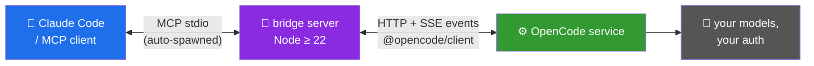

<div align="center">

# 🌉 opencode-bridge-mcp

**Delegate coding work to [OpenCode](https://opencode.ai) from Claude Code — or any MCP client.**

[](https://nodejs.org)
[](https://opencode.ai)
[](https://modelcontextprotocol.io)
[](#-testing)
[](#-license)

Start tasks, block for results, follow up, cancel — the delegating agent finally gets to **read the answer**, not just the status.

</div>

---

## ✨ Why this exists

Delegating work to another agent is the easy part. Getting the *result* back is where bridges usually break:

- ❌ Tools that report `status: "completed"` — and never the accumulated output text
- ❌ Windows `shell: true` wrappers around `opencode run` with 8191-char argv limits
- ❌ Heuristic "input_required" detection that can never fire because the CLI process already exited
- ✅ **This bridge**: pure HTTP to the OpenCode background service, real session IDs, and `opencode_wait` returns the final assistant text, cost, and tokens



**Key design choices:**

| Choice | Why |
|---|---|
| stdio transport | Claude Code auto-spawns the server — no daemon to manage |
| Shared background service | Delegated sessions share your models, auth, agents, and history with the TUI |
| No process spawning | The whole `shell: true` / argv-length / `taskkill` bug class is structurally gone |
| Restart-safe | State rebuilds from `session.list` + `session.get`; `wait()` on an idle session resolves instantly |
| Small tool surface | Six well-documented tools beat thirty overlapping ones |

---

## 📦 Install

**Prerequisites:** [Node ≥ 22](https://nodejs.org), OpenCode CLI `2.2.7` ([install](https://opencode.ai/docs/)), and one `opencode auth login`.

```bash
git clone <this-repo> && cd opencode-bridge-mcp
npm install
npm run build
```

<details>
<summary><b>Windows (PowerShell) — full walkthrough</b></summary>

```powershell
git clone <this-repo>; cd opencode-bridge-mcp
npm install
npm run build
npm test        # unit + E2E against your live service
```

The service registry lives at `~\.local\state\opencode\service.json`. The bridge finds it automatically — nothing to configure.

</details>

---

## 🔌 Register with your client

**Claude Code:**

```bash
claude mcp add opencode -- node /absolute/path/to/opencode-bridge-mcp/dist/index.js
```

Verify inside Claude Code with `/mcp` — you should see six `opencode_*` tools.

**Any other MCP client** — point the stdio server config at `dist/index.js`:

```jsonc
{
  "mcpServers": {
    "opencode": {
      "command": "node",
      "args": ["/absolute/path/to/opencode-bridge-mcp/dist/index.js"]
    }
  }
}
```

> **Note:** one bridge process per client is fine — delegated work lives in the OpenCode service, and the bridge rebuilds its view after any restart.

---

## 🛠️ Tools

### `opencode_task` — start work *(non-blocking)*

```ts
task: string      // the full task; required
title?: string    // default "Task <first 40 chars>"
agent?: string    // "build" | "plan" | "explore" | ...
model?: string    // "provider/model" or "provider/model#variant"
directory?: string// working directory; default process.cwd()
```

```jsonc
// → returns immediately
{ "sessionId": "ses_...", "title": "...", "status": "working" }
```

### `opencode_wait` — get the answer *(blocking)* ⭐

The headline feature. Blocks until the session finishes, then returns what the worker actually said.

```ts
sessionId: string
timeoutMs?: number  // default 300000 (5 min); on expiry returns { status: "timeout" } — call again to keep waiting
```

```jsonc
{
  "sessionId": "ses_...",
  "status": "succeeded",          // | "failed" | "interrupted" | "timeout"
  "result": "<final assistant text>",  // capped at 100 KB; "truncated": true when cut
  "cost": 0.0021,
  "tokens": { "input": 1840, "output": 96, "reasoning": 0, "cache": { "read": 2048, "write": 0 } }
}
```

### `opencode_status` — what's running? *(non-blocking)*

```ts
sessionId?: string  // detail one session
limit?: number      // summary mode: max sessions; default 10, max 50
```

```jsonc
{ "sessions": [ { "sessionId": "ses_...", "title": "...", "status": "busy", "outcome": "succeeded",
    "cost": 0.0021, "tokens": { /* ... */ }, "time": { "created": 1763000000000, "updated": 1763000100000 } } ],
  "total": 1 }
```

### `opencode_respond` — multi-turn follow-up *(non-blocking)*

The session keeps full context. Give it a codeword in turn one, ask for it in turn three — it remembers.

```ts
sessionId: string
message: string    // next user turn
```

```jsonc
{ "sessionId": "ses_...", "status": "working", "message": "Follow-up delivered; use opencode_wait" }
```

### `opencode_cancel` — stop a runaway session

```ts
sessionId: string
```

```jsonc
{ "sessionId": "ses_...", "status": "interrupted", "interrupted": true }
```

### `opencode_health` — is everything alive?

```jsonc
{ "service": { "url": "http://127.0.0.1:28894", "version": "2.2.7", "pid": 25204 },
  "trackedSessions": 2, "working": 1, "subscriptionActive": true }
```

---

## 🧪 Testing

```bash
npm test           # 35 tests: unit (mocked) + E2E (live service, real stdio)
npm run test:unit  # 32 unit tests only
npm run test:e2e   # E2E only: spawns dist/index.js, full lifecycle over JSON-RPC
npm run lint       # tsc --noEmit
```

The E2E harness spawns `dist/index.js` with piped stdio, drives it with newline-delimited JSON-RPC (promise map keyed by request id), and asserts the full flow: **task → wait returns result → multi-turn memory → status → cancel interrupts**.

---

## 🩺 Troubleshooting

| Symptom | Fix |
|---|---|
| `OpenCode service not found` | Run `opencode` once (TUI) or `opencode serve`; the bridge also auto-starts via `ensure()` |
| Tools fail after CLI upgrade | `@opencode/client` is pinned to the CLI version — bump it to match, rebuild |
| Auth failures after service restart | The service password rotates on restart; the bridge re-discovers automatically — nothing to do |
| `SyntaxError: await using` | You're running a package that needs Node ≥ 24; this bridge needs only ≥ 22 |

---

## 📌 Version pinning

`@opencode/client` **must track the OpenCode CLI version exactly** (currently `2.2.7`). On CLI upgrade:

```bash
npm install @opencode/client@<new-cli-version>
npm run build && npm test
```

---

## 🗺️ Roadmap

- [ ] Model picker convenience (`model.json` recent list as a tool)
- [ ] Optional `archived` cleanup for bridge-created sessions
- [ ] npm publish

---

## 📄 License

MIT
